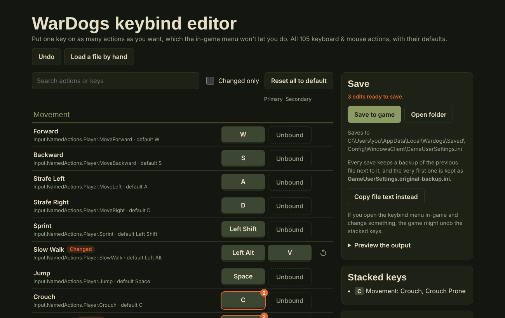

# WarDogs Keybind Editor

The in-game keybind menu in **WarDogs** won't let you put one key on two actions. This tool edits your settings file directly so you can, for example Raise Collective with 'Space' and still jump with 'Space'.



## Download

Download **WD-Keybind-Editor-v1.2.zip** from the [Releases](../../releases) page. Right-click it, choose **Extract All**, and open the extracted folder.

## How to use

1. Run `WD-Keybind-Editor.exe` from the extracted folder. Don't run it from inside the zip. A small console window opens and the editor opens in your web browser. Keep the console window open while you edit.
2. Your settings load automatically. Click any key to rebind it: press a key, click a mouse button, or scroll. The same key can go on as many actions as you like.
3. Click **Save to game**. If WarDogs is open, the editor warns you first; click **Save anyway**.
4. **Reload the game** to apply your changes. Changes made in the editor don't take effect in a running game until you reload.
5. Close the console window when you're done.

> **Tip:** I recommend keeping WarDogs open in the **firing range** while you edit, so you can test your binds right away. Just remember each change needs a reload before it works. While testing, don't change binds in the game's own keybind menu, or the game may overwrite what you saved.

> **If your settings don't load automatically:** click **Load a file by hand** and pick your `GameUserSettings.ini` yourself. It's usually at `%LOCALAPPDATA%\Wardogs\Saved\Config\WindowsClient\GameUserSettings.ini` (paste that into the File Explorer address bar).

## What it does (and doesn't do)

- Lists all 105 keyboard & mouse actions from the game's keybind menu, with their defaults, a reset button for each, and **Reset all to default**.
- Hold / Toggle settings for crouch, prone, sprint, ADS and the rest.
- Only ever touches one file: `%LOCALAPPDATA%\Wardogs\Saved\Config\WindowsClient\GameUserSettings.ini`.
- Makes a backup before every save (`GameUserSettings.backup-<date>.ini`), and keeps your very first file as `GameUserSettings.original-backup.ini`. To undo everything, rename that one back to `GameUserSettings.ini`.
- Runs only on your PC (`127.0.0.1`). It doesn't connect to the internet or send anything anywhere.
- Doesn't touch the game itself, its files or memory, just the settings file the game's own menu writes.
- Keyboard & mouse only for now. HOTAS and gamepad binds are left alone.

## Notes

- **"Windows protected your PC":** the exe isn't code-signed, so Windows warns about it. Click **More info → Run anyway**. You can check the code here or build it yourself (below).
- If you change binds in the game's own keybind menu afterwards, the game may undo your stacked keys. Just save again from the editor.
- Defaults were recorded from the game's keybind menu on Nov 24, 2026. A game update could add or rename actions.

## Build it yourself

Needs [Go](https://go.dev/dl/) 1.24 or newer.

```
go build -ldflags="-s -w" -o WD-Keybind-Editor.exe .
```

`main.go` is the small local server that reads and saves the file. `index.html` is the whole editor.

## About this project

This was **vibe coded**: I described what I wanted and built it together with an AI (Claude). I'm not a professional developer, and there's nothing special about it. Anyone could have made this. I just wanted to stack my keybinds and figured others might too. Test it, keep the backups it makes, and report anything weird in [Issues](../../issues).

## Use it however you want (just not for money)

Anyone can download it, change it, fork it, re-upload it or build on it for free. There are two conditions:

1. **Credit me** (**Sezington**) as the original creator, with a link back to this repo, and say if you changed anything.
   You can take credit for your own changes and additions. Put your name on what you added, as long as I'm still credited for the original.
2. **No making money off it.** Don't sell it or anything built from it, and don't put it behind a paywall, subscription or donation gate.

This is the [Creative Commons Attribution-NonCommercial 4.0](https://creativecommons.org/licenses/by-nc/4.0/) license (CC BY-NC 4.0). See [LICENSE](LICENSE).

---

Fan-made tool, not affiliated with the WarDogs developers.
